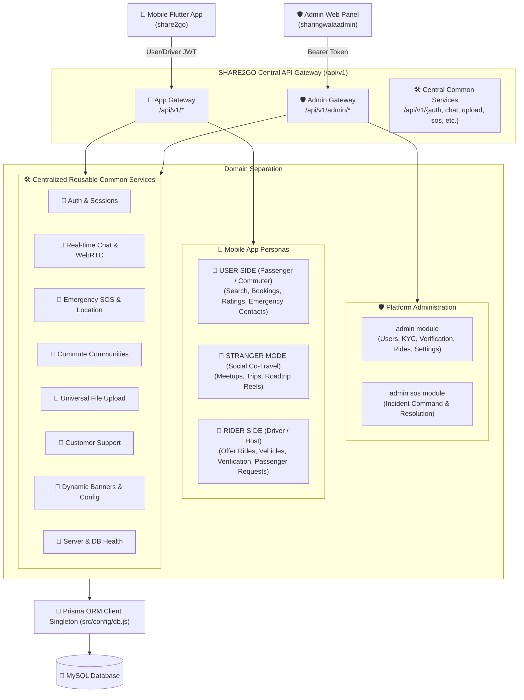

# 🏛️ SHARE2GO Backend System Architecture & Folder Guide

> **Architectural Pattern**: Modular Monolith (Clean Architecture)  
> **API Version**: `v1` (`/api/v1`)  
> **Database**: MySQL via Prisma ORM  
> **Real-time Protocol**: WebSocket (Socket.io) + WebRTC (Mesh Signaling)  
> **Push Notifications**: Firebase Cloud Messaging (FCM HTTP v1)

---

## 📌 1. High-Level Architectural Overview

The SHARE2GO backend is partitioned into **3 Primary Domains**, ensuring absolute separation of concerns while keeping shared services fully reusable:



---

## 📁 2. Professional Directory Structure

```text
D:\node_projects\SHARE2GO\
│
├── client-api/                      # 🎯 Centralized Reusable JavaScript API Client SDK
│   ├── modules/
│   │   ├── admin.api.js             # 🛡️ Admin Portal API methods (Stats, Users, Drivers, KYC, Rides)
│   │   ├── user.api.js              # 👤 Passenger API methods (Search, Book, History, Ratings)
│   │   ├── rider.api.js             # 🚗 Driver/Host API methods (Offer Ride, Vehicles, Requests)
│   │   ├── stranger.api.js          # 🌟 Stranger Mode (Co-travel, Reels, Meetups)
│   │   ├── auth.api.js              # 🔐 Login, OTP, Profile API methods
│   │   ├── chat.api.js              # 💬 Messaging & Socket methods
│   │   └── communities.api.js       # 🏢 Communities methods
│   ├── config.js                    # Base URLs & Token Storage handlers
│   ├── httpClient.js                # Axios instance with auto-auth interceptors
│   ├── socketClient.js              # Socket.io connection manager
│   └── index.js                     # Unified barrel export (api.admin, api.app, api.common)
│
├── prisma/
│   ├── schema.prisma                # Single Source of Truth for Database Models & Relations
│   └── migrations/                  # Versioned schema migration history
│
├── public/
│   └── uploads/                     # Statically served files (avatars, ride photos, videos)
│
└── src/
    ├── app.js                       # Express app configuration & middleware pipeline
    ├── server.js                    # HTTP server startup, Socket.io initialization, DB connect
    │
    ├── config/                      # Infrastructure & Environment Singletons
    │   ├── db.js                    # Prisma connection singleton (prevents pool exhaustion)
    │   ├── env.js                   # Validated environment variables
    │   ├── firebase.js              # FCM push notification helper
    │   └── socket.js                # Socket.io server instance
    │
    ├── middlewares/                 # Cross-Cutting Middlewares
    │   ├── auth.middleware.js       # User & Rider JWT validation
    │   ├── adminAuth.middleware.js  # Staff & Super Admin RBAC validation
    │   ├── validate.middleware.js   # Zod request validation runner
    │   ├── error.middleware.js      # Global error handling pipeline
    │   └── upload.middleware.js     # Multer file upload handler
    │
    ├── routes/                      # 🌐 Centralized Semantic Route Gateways
    │   ├── index.js                 # Master API gateway (mounted at /api/v1)
    │   ├── admin.routes.js          # 🛡️ Platform Administration Gateway (/api/v1/admin/*)
    │   ├── app.routes.js            # 📱 Mobile App Gateway (User & Rider personas)
    │   └── common.routes.js         # 🛠️ Centralized Reusable Common Services Gateway
    │
    ├── modules/                     # 📦 Feature Modules (Clean Architecture)
    │   │
    │   ├── 🛡️ ADMIN PLATFORM
    │   │   └── admin/               # Staff auth, KPIs, user review, KYC, rides oversight
    │   │       ├── admin.routes.js
    │   │       ├── admin.controller.js
    │   │       ├── admin.service.js
    │   │       └── admin.validation.js
    │   │
    │   ├── 📱 APP PLATFORM — USER SIDE (Passenger / Commuter)
    │   │   ├── user/                # Profile, search rides, seat requests, feedback
    │   │   │   ├── user.routes.js
    │   │   │   ├── user.controller.js
    │   │   │   ├── user.service.js
    │   │   │   └── user.validation.js
    │   │   │
    │   │   └── stranger/            # Social co-travel trips, meetups, roadtrip reels
    │   │       ├── stranger.routes.js
    │   │       ├── stranger.controller.js
    │   │       ├── stranger.service.js
    │   │       └── stranger.validation.js
    │   │
    │   ├── 📱 APP PLATFORM — RIDER SIDE (Driver / Vehicle Owner / Host)
    │   │   └── rider/               # Verification, vehicles, offer rides, trip lifecycle
    │   │       ├── rider.routes.js
    │   │       ├── rider.controller.js
    │   │       ├── rider.service.js
    │   │       └── rider.validation.js
    │   │
    │   └── 🛠️ CENTRALIZED COMMON & REUSABLE SERVICES
    │       ├── auth/                # Phone OTP verification, JWT access & refresh tokens
    │       ├── chat/                # 1-on-1 direct conversations & WebRTC signaling
    │       ├── sos/                 # Emergency SOS triggers & administrative incident desk
    │       ├── communities/         # Corporate, university & neighborhood hubs
    │       ├── upload/              # Media & document upload pipeline
    │       ├── support/             # Customer support tickets & FAQ
    │       ├── common/              # In-app carousel banners, city lists, dynamic config
    │       └── health/              # System uptime, memory & MySQL connection probe
    │
    └── utils/                       # Shared Helpers & Protocols
        ├── apiError.js              # Standardized HTTP error class
        ├── apiResponse.js           # Standardized JSON response envelope
        ├── asyncHandler.js          # Controller try/catch abstraction wrapper
        ├── token.util.js            # JWT sign & verify helpers
        └── urlHelper.js             # Universal absolute media URL resolver
```

---

## 🎯 3. Persona & Route Breakdown

### 🛡️ 1. Platform Administration (`/api/v1/admin`)
| Base Route | Purpose | Access Control |
| :--- | :--- | :--- |
| `/api/v1/admin/auth/*` | Staff login, refresh tokens, profile, change password | Public / Admin JWT |
| `/api/v1/admin/dashboard/*` | Real-time stats, revenue charts, recent activity feed | `authenticateAdmin` |
| `/api/v1/admin/users/*` | Commuter directory, deep inspect, edit, block/suspend | `users.view`, `users.block` |
| `/api/v1/admin/drivers/*` | Review driving license, approve/reject driver applications | `drivers.verify` |
| `/api/v1/admin/vehicles/*` | Review vehicle registration, RC, insurance documents | `vehicles.verify` |
| `/api/v1/admin/rides/*` | Platform-wide rides oversight & emergency cancellations | `rides.view`, `rides.cancel` |
| `/api/v1/admin/trips/*` | Stranger Mode trips oversight & administrative controls | `trips.view`, `trips.cancel` |
| `/api/v1/admin/bookings/*` | Global booking records and dispute status overrides | `bookings.view` |
| `/api/v1/admin/sos/*` | Emergency incident monitoring, acknowledge, and resolve | `sos.manage` |
| `/api/v1/admin/reports/*` | Passenger/Driver safety reports & resolution logs | `reports.resolve` |
| `/api/v1/admin/communities/*`| Create, modify, and delete corporate commute circles | `communities.manage` |
| `/api/v1/admin/pricing-rules` | Dynamic per-km pricing caps and platform commission rules | `pricing.manage` |
| `/api/v1/admin/banners/*` | Create and manage in-app promotional home banners | `banners.manage` |
| `/api/v1/admin/staff/*` | Super Admin staff creation, permission assignment | Super Admin |
| `/api/v1/admin/audit-logs` | Immutable audit trail for all admin actions taken | Super Admin |

---

### 📱 2. App Platform — User Side (`/api/v1/user` & `/api/v1/stranger`)
| Base Route | Purpose | Key Actions |
| :--- | :--- | :--- |
| `/api/v1/user/rides/search` | Search available carpools & bikepools | Origin, destination, date, mode filters |
| `/api/v1/user/rides/:id/request-seat`| Request to book seats in an offered ride | Pickup note, seats requested |
| `/api/v1/user/my-rides` | Commuter's active & past booking history | Status filter (CONFIRMED, COMPLETED) |
| `/api/v1/user/rides/:id/feedback` | Rate driver and submit ride review | 1-5 star rating + feedback text |
| `/api/v1/user/trusted-contacts` | Emergency trusted contacts | Add, update, delete trusted contacts |
| `/api/v1/user/profile` | Commuter profile & commute preferences | Home area, work area, women-only mode |
| `/api/v1/stranger/trips` | Discover social co-travel trips | Intercity commute, weekend getaways |
| `/api/v1/stranger/reels` | Explore travel video reels & roadtrips | Stream full network/local video URLs |

---

### 📱 3. App Platform — Rider Side (`/api/v1/rider`)
| Base Route | Purpose | Key Actions |
| :--- | :--- | :--- |
| `/api/v1/rider/status` | Check driver application status | Verification status (PENDING, APPROVED) |
| `/api/v1/rider/apply` | Submit driver license & identity KYC | DL number, photo, vehicle type |
| `/api/v1/rider/vehicles` | Manage driver's vehicles | Add car/bike, upload RC & insurance |
| `/api/v1/rider/rides/offer` | Publish a new shared ride | Route, date, time, price, seats, preferences |
| `/api/v1/rider/my-offered-rides` | Host's published & completed rides list | View passenger manifests and earnings |
| `/api/v1/rider/requests/:id/respond`| Accept or decline booking request | Accept seat, send confirmation push |
| `/api/v1/rider/rides/:id/start` | Start ride journey | Triggers live tracking notification |
| `/api/v1/rider/rides/:id/complete`| Complete ride journey | Finalizes bookings and unlocks ratings |

---

### 🛠️ 4. Centralized Common & Reusable Services
| Base Route | Purpose | Consumers |
| :--- | :--- | :--- |
| `/api/v1/auth/*` | Phone OTP login, token refresh, logout | User, Rider, Admin |
| `/api/v1/chat/*` | Real-time 1-on-1 conversations & call logs | User & Rider |
| `/api/v1/upload/*` | High-performance media & document uploads | User, Rider, Admin |
| `/api/v1/sos/*` | Panic button trigger & emergency dispatch | User & Rider |
| `/api/v1/communities/*`| Join verified corporate or university circles | User & Rider |
| `/api/v1/support/*` | Submit support ticket & view FAQs | User & Rider |
| `/api/v1/common/*` | Dynamic carousel banners & app configuration | User & Rider |
| `/api/v1/health` | Uptime check & MySQL DB connectivity probe | DevOps & Monitors |

---

## 💎 4. Standardized Coding Protocols

### 1. Controllers Wrapped in `asyncHandler`
All controllers MUST be wrapped in `asyncHandler` so that unhandled rejections are cleanly caught by the global error middleware:
```javascript
export const getProfile = asyncHandler(async (req, res) => {
  const profile = await userService.getProfile(req.user.id);
  return res.status(200).json(new ApiResponse(200, profile, 'Profile retrieved successfully'));
});
```

### 2. Standardized Responses via `ApiResponse`
Never send raw JSON without the standardized envelope:
```javascript
new ApiResponse(statusCode, data, message)
// Generates: { success: true, statusCode: 200, message: "...", data: {...} }
```

### 3. Controlled Errors via `ApiError`
Never throw bare `Error` objects for HTTP exceptions:
```javascript
throw new ApiError(404, 'Ride not found or already completed');
throw new ApiError(403, 'You do not have permission to modify this ride');
```

### 4. Prisma Singleton (`src/config/db.js`)
All database operations MUST import the connection singleton from `src/config/db.js`:
```javascript
import { prisma } from '../../config/db.js';
```
Do NOT instantiate `new PrismaClient()` inside services or controllers.

