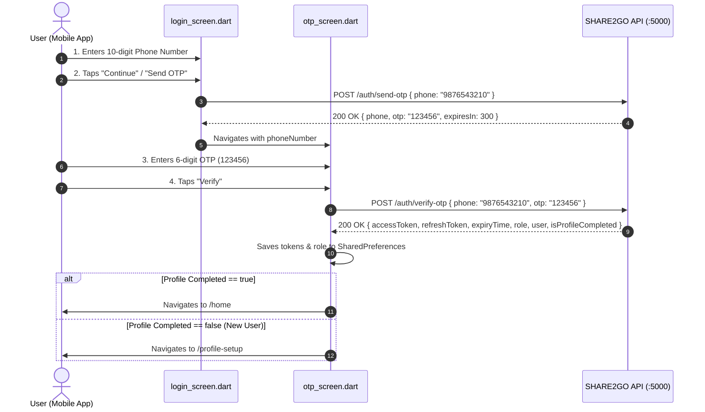

# SHARE2GO — Send OTP & Verify OTP Integration Guide

> **Base Server URL:** `http://172.20.10.2:5000/api/v1`  
> **Target Screens:** `login_screen.dart` & `otp_screen.dart`  
> **Development Bypass OTP:** `123456` (Master OTP)

---

## 📱 Complete 2-Step Authentication Architecture



---

## 🚀 STEP 1: Send OTP (`POST /auth/send-otp`)

### 1.1 Endpoint Overview
* **Method:** `POST`
* **Full URL:** `http://172.20.10.2:5000/api/v1/auth/send-otp`
* **Auth Header Required:** ❌ No
* **Content-Type:** `application/json`

### 1.2 Request Payload
```json
{
  "phone": "9876543210"
}
```
> **Formatting:** You can pass a clean 10-digit number (`9876543210`) or with country code (`+919876543210`). The backend normalizes it automatically.

### 1.3 Success Response (`200 OK`)
```json
{
  "statusCode": 200,
  "success": true,
  "message": "OTP sent successfully to +919876543210",
  "data": {
    "phone": "+919876543210",
    "otp": "123456",
    "expiresIn": 300,
    "resendAvailableIn": 30,
    "message": "OTP sent successfully to +919876543210"
  }
}
```
> **Note for Frontend Testing:** The generated code (`"otp": "123456"`) is returned in `data.otp` so you can auto-fill or display a test SnackBar.

### 1.4 Error Response (`400 Bad Request`)
If phone number is less than 10 digits:
```json
{
  "success": false,
  "statusCode": 400,
  "message": "Validation Error",
  "errors": [
    {
      "field": "phone",
      "message": "Valid 10-digit phone number is required"
    }
  ]
}
```

---

## 🔐 STEP 2: Verify OTP (`POST /auth/verify-otp`)

### 2.1 Endpoint Overview
* **Method:** `POST`
* **Full URL:** `http://172.20.10.2:5000/api/v1/auth/verify-otp`
* **Auth Header Required:** ❌ No
* **Content-Type:** `application/json`

### 2.2 Request Payload
```json
{
  "phone": "9876543210",
  "otp": "123456"
}
```
> **Master Bypass Code:** In development mode, `123456` (or `1234`) will always pass instantly in `< 80ms`.

### 2.3 Success Response (`200 OK`)
Returns the complete auth bundle: **accessToken**, **refreshToken**, **expiryTime**, **role**, and **user details**:

```json
{
  "statusCode": 200,
  "success": true,
  "message": "OTP verified successfully. Logged in.",
  "data": {
    "tokenType": "Bearer",
    "accessToken": "eyJhbGciOiJIUzI1NiIsInR5cCI6IkpXVCJ9.eyJ1c2VySWQiOiJjbXYybGl1ZG4wMDB3dmFqNGdnbnM4ZjN6Iiwicm9sZSI6IlVTRVIiLCJyb2xlcyI6WyJVU0VSIl0sImlhdCI6MTc5MjE3OTY1MSwiZXhwIjoxNzkyMjY2MDUxfQ...",
    "refreshToken": "eyJhbGciOiJIUzI1NiIsInR5cCI6IkpXVCJ9.eyJ1c2VySWQiOiJjbXYybGl1ZG4wMDB3dmFqNGdnbnM4ZjN6IiwidG9rZW5UeXBlIjoicmVmcmVzaCIsImlhdCI6MTc5MjE3OTY1MSwiZXhwIjoxNzk0NzcxNjUxfQ...",
    "token": "eyJhbGciOiJIUzI1NiIsInR5cCI6IkpXVCJ9...",
    "expiresIn": 86400,
    "expiryTime": "2026-10-18T01:40:51.312Z",
    "refreshTokenExpiresIn": 2592000,
    "refreshTokenExpiryTime": "2026-11-16T01:40:51.314Z",
    "role": "USER",
    "roles": [
      "USER"
    ],
    "isNewUser": false,
    "isProfileCompleted": true,
    "hasDriverProfile": false,
    "user": {
      "id": "cmv2liudn000wvaj4ggns8f3z",
      "uuid": "107e7fa5-cfdf-405f-b1bb-cc5038912f6d",
      "username": "sai_commuter",
      "displayName": "Sai Krishna",
      "phone": "+919876543210",
      "email": "sai@share2go.app",
      "gender": "MALE",
      "status": "ACTIVE",
      "avatarUrl": null,
      "role": "USER",
      "roles": [
        "USER"
      ],
      "driverProfile": null
    }
  }
}
```

### 2.4 Error Response (`400 Bad Request` — Invalid OTP)
If the user types any OTP other than `123456`:
```json
{
  "success": false,
  "statusCode": 400,
  "message": "Invalid OTP code. Please enter 123456 to verify."
}
```

---

## 🛠️ Flutter UI Code Implementation

### 1. `login_screen.dart` (Send OTP Action)

```dart
// In lib/presentation/authentication/login_screen.dart
void _onContinuePressed() async {
  final phone = _phoneController.text.trim();
  if (phone.length < 10) {
    ScaffoldMessenger.of(context).showSnackBar(
      const SnackBar(content: Text('Please enter a valid 10-digit mobile number')),
    );
    return;
  }

  setState(() => _isLoading = true);

  try {
    // 1. Call Backend to Send OTP
    final data = await ApiService.sendOtp(phone);

    setState(() => _isLoading = false);

    // 2. Navigate to OTP verification screen passing the phone
    context.push('/otp', extra: {
      'phone': phone,
      'testOtp': data['otp'], // Available for dev quick testing
    });
  } catch (e) {
    setState(() => _isLoading = false);
    ScaffoldMessenger.of(context).showSnackBar(
      SnackBar(content: Text(e.toString().replaceAll('Exception: ', ''))),
    );
  }
}
```

---

### 2. `otp_screen.dart` (Verify OTP Action)

```dart
// In lib/presentation/authentication/otp_screen.dart
void _onVerifyPressed() async {
  final otp = _pinController.text.trim();
  if (otp.length < 4) {
    setState(() => _errorMessage = "Please enter 6-digit OTP");
    return;
  }

  setState(() {
    _isLoading = true;
    _errorMessage = null;
  });

  try {
    // 1. Call Verify OTP API
    final data = await ApiService.verifyOtp(widget.phoneNumber, otp);

    // 2. ApiService.saveAuthSession() automatically saves:
    //    - accessToken
    //    - refreshToken
    //    - role ('USER' or 'RIDER')
    //    - expiryTime
    final bool isProfileCompleted = data['isProfileCompleted'] ?? false;
    final String role = data['role'] ?? 'USER';

    setState(() => _isLoading = false);

    // 3. Smart routing based on profile completeness
    if (isProfileCompleted) {
      context.go('/home');
    } else {
      context.go('/profile-setup');
    }
  } catch (e) {
    setState(() {
      _isLoading = false;
      _errorMessage = e.toString().replaceAll('Exception: ', '');
    });
  }
}
```

---

## 🔄 3. Token Refresh (Automatic Background Refresh)

When the 24-hour `accessToken` expires, call `ApiService.refreshToken()`:

* **Endpoint:** `POST /api/v1/auth/refresh-token`
* **Body:**
```json
{
  "refreshToken": "<stored_refresh_token>"
}
```
* Automatically stores the new `accessToken` and updates the expiry time in `SharedPreferences`.

---

## 🧪 Quick Test Commands (cURL / Terminal)

#### Test Send OTP:
```bash
curl -X POST http://172.20.10.2:5000/api/v1/auth/send-otp \
  -H "Content-Type: application/json" \
  -d '{"phone": "9876543210"}'
```

#### Test Verify OTP with Master Bypass (`123456`):
```bash
curl -X POST http://172.20.10.2:5000/api/v1/auth/verify-otp \
  -H "Content-Type: application/json" \
  -d '{"phone": "9876543210", "otp": "123456"}'
```

#### Test Verify OTP with Wrong Code (`999999`):
```bash
curl -X POST http://172.20.10.2:5000/api/v1/auth/verify-otp \
  -H "Content-Type: application/json" \
  -d '{"phone": "9876543210", "otp": "999999"}'
```
*(Will return `400: Invalid OTP code. Please enter 123456 to verify.`)*
